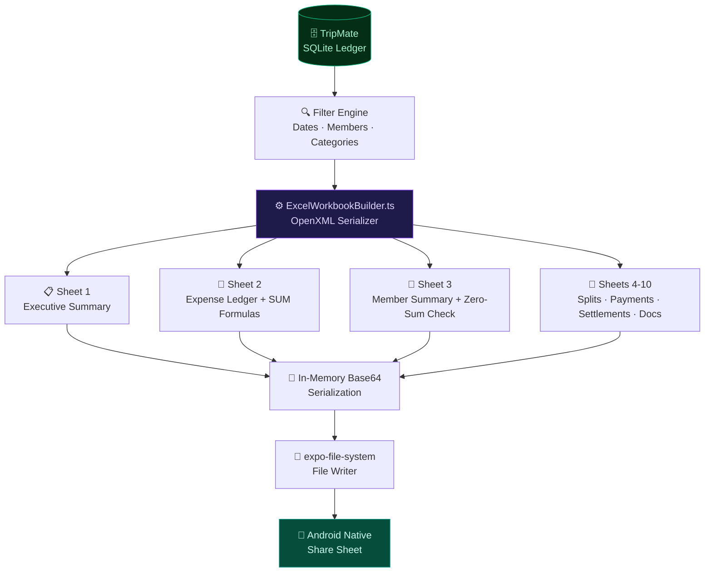
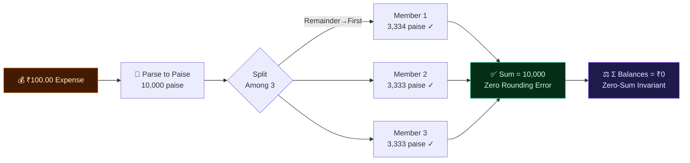
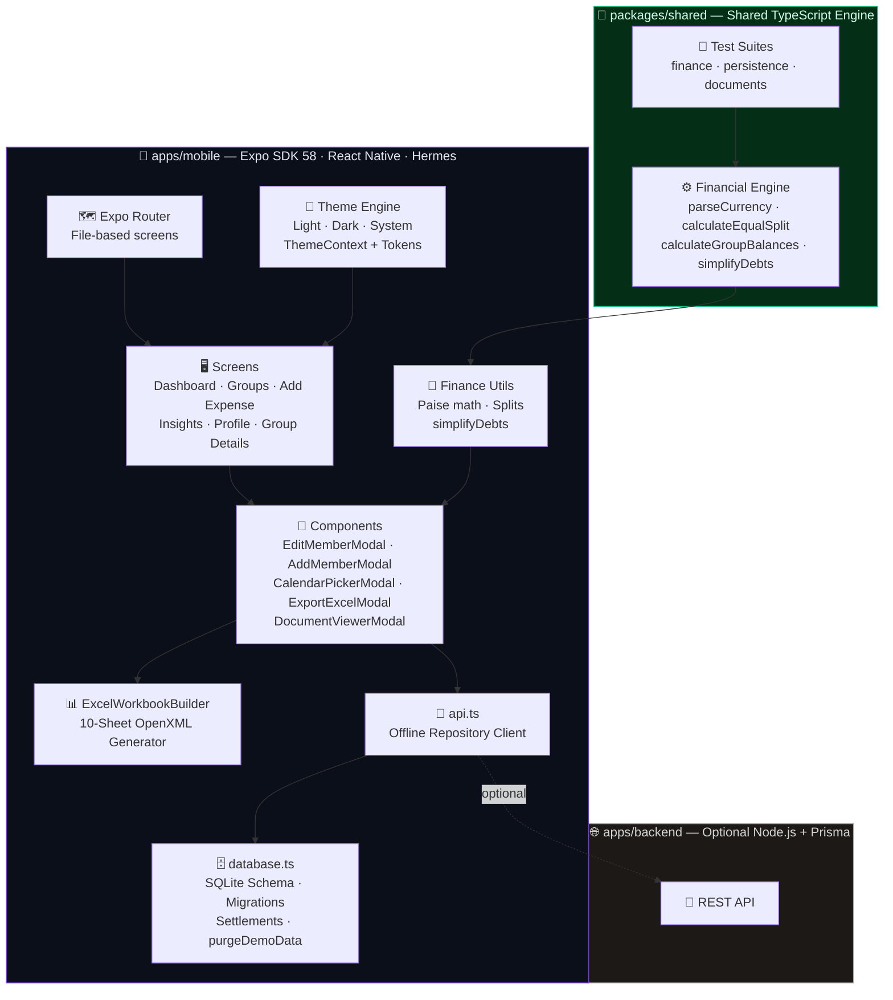

<div align="center">

<!-- HERO WAVE TOP -->


<!-- APP LOGO -->
<br />
<a href="#-tripmate">
  
</a>

<br /><br />

<!-- ANIMATED TYPING -->
<a href="https://github.com/YashSurve2006/tripmate/releases">
  
</a>

<br /><br />

<!-- BADGE ROW 1 — RELEASE -->
<a href="https://github.com/YashSurve2006/tripmate/releases">
  
</a>


<br /><br />

<!-- BADGE ROW 2 — TECH STACK -->


<br /><br />

<!-- GRADIENT STATS STRIP -->


</div>

<!-- WAVE SEPARATOR -->


---

## ⚡ Feature Overview

<div align="center">


<br />

| | Feature | Highlights |
|:---:|:---|:---|
| 📊 | **Advanced Excel Export** | 10 dedicated sheets · Real numeric cells · `=SUM()` formulas · OpenXML standard |
| 👥 | **Manual Member Management** | Add by name offline · Direct dialer · WhatsApp shortcut · Avatar color picker |
| ⚖️ | **Settle-Up Engine** | Instant debt disappearance · Greedy simplification · Zero-sum invariant |
| 📅 | **Interactive Calendar** | Month grid picker · Quick presets · Custom group types |
| 🧮 | **Paise Precision Math** | Integer minor units · Zero rounding errors · Deterministic remainder |
| 🧾 | **Bills & Documents Vault** | Camera + Gallery + PDF · Per-group isolation · Full-screen viewer |
| 🌗 | **Dynamic Theme Engine** | Light · Dark · Auto OLED · Zero flicker · Persistent |
| 🧼 | **Clean Slate Launch** | Zero demo data · No ghost users · Pure fresh start |

</div>

---

## 📥 Install TripMate

<div align="center">

<!-- GLOWING DOWNLOAD BUTTON VIA SHIELD -->
<br />

[](https://github.com/YashSurve2006/tripmate/releases)

<br /><br />

| Property | Value |
|:---:|:---|
| 📁 **File** | `TripMate-release.apk` |
| 📏 **Size** | 99.3 MB (104,171,667 bytes) |
| 🏗️ **Architectures** | `arm64-v8a` · `armeabi-v7a` · `x86` · `x86_64` |
| 📱 **Min Android** | 8.0+ (API Level 26) |
| 🔌 **Internet Required** | ❌ Never |
| 🗄️ **Database** | Local SQLite — Your data stays on your phone |

</div>

### ⚡ Install in 30 Seconds

```
  1  Transfer  →  Send TripMate-release.apk via USB / WhatsApp / Google Drive
  2  Allow     →  Settings > Apps > Install Unknown Apps > Allow your file manager
  3  Tap       →  Open APK in Files/Downloads and tap Install
  4  Done      →  TripMate launches 100% offline, instantly
```

> 🔄 **Updating?** Install new APK directly over the existing one. All your groups, expenses, settlements, and receipts are preserved — zero data loss, no uninstall needed.

---

## 📱 App Screenshots

<div align="center">


<br />

<table>
  <tr>
    <td align="center">
      <a href="./docs/screenshots/01_dashboard.jpg">
        
      </a>
      <br /><br />
      
      <br />
      <sub>Date-range filters · Spending KPIs<br/>Budget bar · Category tiles</sub>
    </td>
    <td align="center">
      <a href="./docs/screenshots/02_group_details.jpg">
        
      </a>
      <br /><br />
      
      <br />
      <sub>6-Tab hub · Excel export header<br/>Budget ring · Debt transfers</sub>
    </td>
    <td align="center">
      <a href="./docs/screenshots/03_documents_vault.jpg">
        
      </a>
      <br /><br />
      
      <br />
      <sub>Camera · Gallery · PDF<br/>Category filters · Full-screen view</sub>
    </td>
  </tr>

  <tr>
    <td align="center">
      <a href="./docs/screenshots/04_add_expense.jpg">
        
      </a>
      <br /><br />
      
      <br />
      <sub>Paise-precision splits · Receipt preview<br/>Multi-payer · Category tags</sub>
    </td>
    <td align="center">
      <a href="./docs/screenshots/05_insights_analytics.jpg">
        
      </a>
      <br /><br />
      
      <br />
      <sub>Donut charts · Debt flow graph<br/>Top spender · Burn rate</sub>
    </td>
    <td align="center">
      <a href="./docs/screenshots/06_dark_mode_profile.jpg">
        
      </a>
      <br /><br />
      
      <br />
      <sub>OLED dark navy · Theme switcher<br/>UPI ID · SQLite DB status</sub>
    </td>
  </tr>
</table>

</div>

---

## 🔥 Core Features

<div align="center">

</div>

TripMate generates genuine multi-tab Excel workbooks using `xlsx` (SheetJS) — fully compliant with the OpenXML standard. Opens natively in Excel, Google Sheets, LibreOffice, and Apple Numbers.



<div align="center">

| # | Sheet Name | Contents |
|:---:|:---|:---|
| 1 | 📋 **Executive Summary** | Group KPIs, dates, budget variance, zero-sum verification |
| 2 | 📑 **Expense Ledger** | Itemized log — real numeric cells (`t:'n'`) + `=SUM()` formulas |
| 3 | 👥 **Member Summary** | Paid, share, repayments made/received, net balances |
| 4 | 💳 **Payment Records** | Who paid how much per expense |
| 5 | ✂️ **Split Details** | Exact paise allocation per participant |
| 6 | ✅ **Settlement History** | Confirmed repayments with timestamps |
| 7 | ⚖️ **Outstanding Balances** | Minimal transfer pairs (who owes whom) |
| 8 | 🏷️ **Category Analysis** | Total spent and percentage per category |
| 9 | 📅 **Daily Spending** | Chronological daily burn rate + cumulative |
| 10 | 🧾 **Receipts & Documents** | Document index with filenames and sizes |

</div>

---

<div align="center">

</div>

Add and manage members **100% offline** — no invite codes, signups, or internet ever needed.

<div align="center">

| Feature | Icon | Description |
|:---|:---:|:---|
| **Add by Name** | 🖊️ | Type any name and instantly add them to the group |
| **Direct Phone Dialer** | 📞 | One-tap `tel:` link launches the Android dialer |
| **WhatsApp Shortcut** | 💬 | Instant `wa.me/` deep-link for settlement nudges |
| **Copy Profile Info** | 📋 | Clipboard copy with animated "Copied!" toast |
| **Live Avatar Customizer** | 🎨 | 10-color glow ring picker with live initials preview |
| **Role Radio Cards** | 🔘 | Visual card selector for Member vs Admin with descriptions |
| **Financial Hero Bar** | 📊 | Total Paid · Fair Share · Net Balance (colored status) |
| **Accordion Danger Zone** | 🛡️ | Collapsible removal section with ledger archival explanation |
| **Safe Archival** | 🗂️ | Members with history archived (not deleted) — zero-sum preserved |

</div>

---

<div align="center">

</div>

```
 BEFORE SETTLEMENT                    AFTER ONE TAP → SETTLE
 ─────────────────────────            ─────────────────────────────────
  Rahul  ──owes ₹1,200──▶ Yash        ✅  Transfer card DISAPPEARS
  Anisha ──owes ₹800───▶  Yash        ✅  All net balances recompute
  Priya  ──owes ₹600───▶  Rahul       ✅  Settlement persisted to history
                                       ✅  "All Settled Up! 🎉" if ₹0 owed
```

- **Greedy Debt Simplification** — `simplifyDebts()` converts N-party cycles into the **minimum** direct bilateral transfers.
- **Zero-Sum Invariant** — `Σ all member balances ≡ 0` at every point in time, always.
- **Live Balance Formula:**

```
Net Balance = (Total Paid − Fair Share) + Settlements Received − Settlements Paid
```

---

<div align="center">

</div>



<div align="center">

| Principle | Implementation |
|:---|:---|
| **Integer Minor Units** | Every value stored as integer paise — no float arithmetic |
| **Deterministic Remainder** | Surplus paise → first member alphabetically: `3334+3333+3333 = 10000` |
| **Zero-Sum Invariant** | `Σ balances ≡ 0` enforced for every group at every instant |
| **Debt Minimization** | Greedy algorithm converts N-party cycles to minimum bilateral transfers |

</div>

---

## 🧪 Test Suite

<div align="center">

[](.)
[](.)
[](.)
[](.)

</div>

```
npm test                       ← 27 unit + integration tests
npx ts-node test-features-e2e  ← 40 financial & Excel E2E tests
```

```
╔══════════════════════════════════════════════════════════════════╗
║              TRIPMATE TEST SUITE — ALL SYSTEMS GO                ║
╠══════════════════════════════════════════════════════════════════╣
║                                                                  ║
║  packages/shared — Financial Engine + Persistence                ║
║  ✅  parseCurrencyToMinorUnits: decimal → integer paise          ║
║  ✅  formatCurrency: paise → ₹ display string                    ║
║  ✅  calculateEqualSplit: ₹100 / 3 → [3334, 3333, 3333]         ║
║  ✅  calculateEqualSplit: throws on empty participants            ║
║  ✅  calculatePercentageSplit: 50/30/20% reconciles exactly       ║
║  ✅  calculateGroupBalances: zero-sum invariant guaranteed        ║
║  ✅  simplifyDebts: 3-party cycle → 2 minimal transfers           ║
║  ✅  Offline persistence: trips + expenses survive restarts       ║
║  ✅  Settlement persistence: balances correct after restart       ║
║  ✅  Document isolation: Group A docs never leak to Group B       ║
║  ✅  Document category + search filtering works correctly         ║
║  ✅  Safe expense unlink: receipt preserved on expense delete     ║
║  ✅  Theme: Light / Dark / System all resolve correctly           ║
║  ✅  + 10 more unit tests passing                                 ║
║                                                                  ║
║  apps/backend — Backend Finance Engine                           ║
║  ✅  Equal split with exact remainder allocation (3 members)      ║
║  ✅  Payments reconciliation validator                            ║
║  ✅  Splits reconciliation validator                              ║
║  ✅  Zero-sum balances + minimal debt transfers                   ║
║                                                                  ║
║  E2E — Member Management + Excel Export (40 tests)               ║
║  ✅  Add 4 members by name (no invite codes)                      ║
║  ✅  Admin vs Member roles preserved correctly                    ║
║  ✅  Workbook contains exactly 10 worksheets                      ║
║  ✅  All 10 sheet names verified (Executive Summary → Receipts)   ║
║  ✅  Expense stored as real numeric cell (42000.00, not string)   ║
║  ✅  Ledger row has genuine Excel =SUM() formula                  ║
║  ✅  Zero-sum invariant: net balances sum = ₹0.00 exactly         ║
║  ✅  Goa Villa payments reconcile to ₹42,000 exactly              ║
║  ✅  Seafood Dinner splits reconcile to ₹13,500 exactly           ║
║  ✅  EXPENSES_ONLY scope → exactly 5 worksheets                   ║
║  ✅  Empty dataset → graceful 10-sheet workbook, no crash         ║
║  ✅  Filename sanitized against invalid filesystem characters     ║
║  ✅  Safe archive: member with history marked inactive            ║
║  ✅  + 27 more E2E tests passing                                  ║
║                                                                  ║
╠══════════════════════════════════════════════════════════════════╣
║  RESULT: 27/27 Unit ✅  |  40/40 E2E ✅  |  0 TypeScript Errors  ║
║  BUILD SUCCESSFUL in 3m 18s  |  APK: 99.3 MB                    ║
╚══════════════════════════════════════════════════════════════════╝
```

---

## 🏗️ Architecture



---

## 📁 Repository Structure

```
📦 TRIPMATE/
│
├── 🚀 TripMate-release.apk               ← Standalone Android APK (built locally / on GitHub Releases)
│
├── 📸 docs/
│   ├── assets/logo.png                    ← App logo & brand mark
│   └── screenshots/                       ← 6 native Android screenshots
│       ├── 01_dashboard.jpg
│       ├── 02_group_details.jpg
│       ├── 03_documents_vault.jpg
│       ├── 04_add_expense.jpg
│       ├── 05_insights_analytics.jpg
│       └── 06_dark_mode_profile.jpg
│
├── 📱 apps/mobile/                        ← Expo SDK 58 React Native App
│   ├── android/                           ← Gradle build system
│   ├── app/                               ← Expo Router screens
│   │   ├── (tabs)/
│   │   │   ├── index.tsx                  ← Live Dashboard
│   │   │   ├── groups.tsx                 ← Groups List
│   │   │   ├── insights.tsx               ← Analytics + Excel
│   │   │   └── profile.tsx                ← Profile + Theme
│   │   ├── groups/
│   │   │   ├── [id].tsx                   ← 6-Tab Group Hub ⭐
│   │   │   └── new.tsx                    ← Create Group + Calendar
│   │   └── add-expense.tsx                ← Add Expense + Split
│   └── src/
│       ├── components/
│       │   ├── common/
│       │   │   ├── EditMemberModal.tsx     ← 💎 Premium member sheet
│       │   │   ├── AddMemberModal.tsx      ← Offline add by name
│       │   │   ├── CalendarPickerModal.tsx ← Month grid picker
│       │   │   ├── ExportExcelModal.tsx    ← Export filters + trigger
│       │   │   └── DocumentViewerModal.tsx ← Full-screen viewer
│       │   └── ui/  (Avatar · Button · Input · EmptyState · Loading)
│       ├── services/
│       │   ├── database.ts                 ← SQLite schema + migrations
│       │   ├── api.ts                      ← Offline repository layer
│       │   └── export/
│       │       ├── ExcelWorkbookBuilder.ts ← 📊 10-sheet generator
│       │       └── ExportFileService.ts    ← File write + share
│       └── theme/  (ThemeContext · tokens)
│
├── 🧮 packages/shared/                    ← Shared financial engine + tests
└── 🌐 apps/backend/                       ← Optional Express + Prisma API
```

---

## 🛠️ Local Dev Setup

<div align="center">

| Tool | Version | Purpose |
|:---:|:---:|:---|
|  | `≥ 20` | Package manager & JS runtime |
|  | `SDK 58` | Mobile dev & bundler |
|  | `21` | Android Gradle build |
|  | `API 26–36` | Device compilation |

</div>

```bash
# Install dependencies
npm install

# Run on Android emulator or device
cd apps/mobile && npx expo start --android

# Run all tests
npm test

# Build release APK
cd apps/mobile/android
set JAVA_HOME=C:\Program Files\Java\jdk-21
set ANDROID_HOME=%LOCALAPPDATA%\Android\Sdk
gradlew.bat assembleRelease --no-daemon
# → Output: apps/mobile/android/app/build/outputs/apk/release/app-release.apk
```

---

## 💾 Local Storage & Data Privacy

- **100% On-Device SQLite**: All trips, expenses, splits, settlements, and member details reside strictly in your phone's internal application storage (`expo-sqlite`).
- **Zero Cloud Dependence**: No external accounts, logins, analytics trackers, or remote telemetry.
- **Backup & Export**:
  - Use the built-in **10-Sheet Excel (.xlsx)** export from any Group Hub to generate a complete backup of expenses, split matrices, and individual balance ledgers.
  - The exported workbook can be shared via WhatsApp, Google Drive, Gmail, or saved to local storage.

---

## ⚠️ Known Limitations

- **Cross-Device Cloud Sync**: Real-time cloud synchronization is intentionally disabled by design for full privacy and offline autonomy.
- **Biometric App Lock**: Currently relies on standard Android system lock screen security.
- **Currency Conversion**: Multi-currency conversion uses fixed exchange rates during an active trip rather than live forex market feeds.

---

## 🤝 Contributing

Contributions, feature suggestions, and bug reports are warmly welcome!

1. **Fork the Repository** on GitHub: [`https://github.com/YashSurve2006/tripmate`](https://github.com/YashSurve2006/tripmate)
2. **Create a Feature Branch**:
   ```bash
   git checkout -b feature/amazing-feature
   ```
3. **Run Typecheck & Test Suite**:
   ```bash
   cd apps/mobile && npx tsc --noEmit
   npm test
   ```
4. **Commit Your Changes**:
   ```bash
   git commit -m "feat: add amazing feature"
   ```
5. **Push to Your Branch & Open a Pull Request**.

---

<!-- FOOTER WAVE -->


<br />


<br /><br />

**Built for Students, Flatmates & Explorers** 🎒

<br />


<br /><br />

<sub><i>TripMate guarantees mathematical accuracy down to the paisa · Offline-First · Zero-Sum Finance · 100% Your Data</i></sub>

</div>
