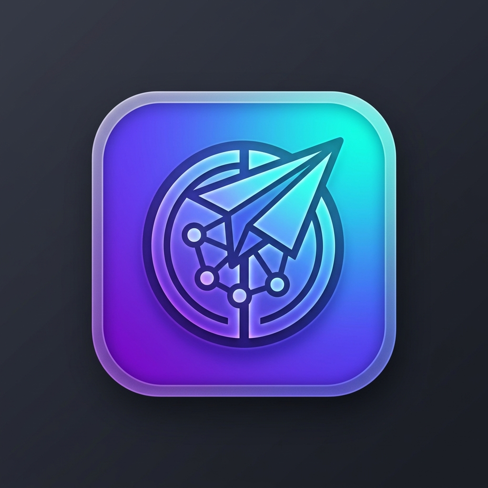
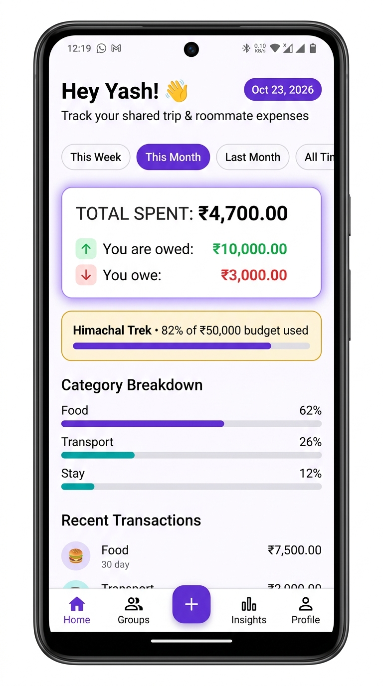
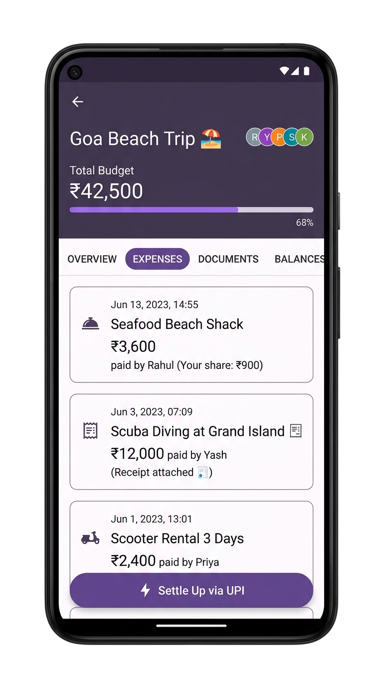
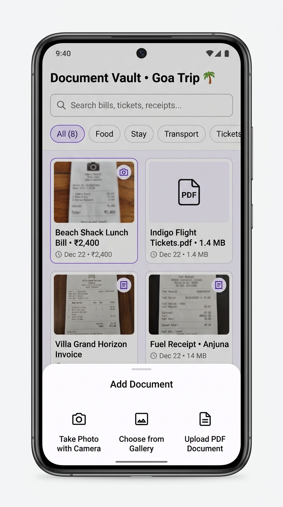
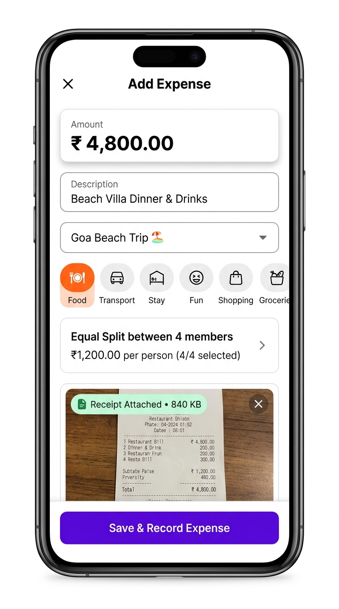
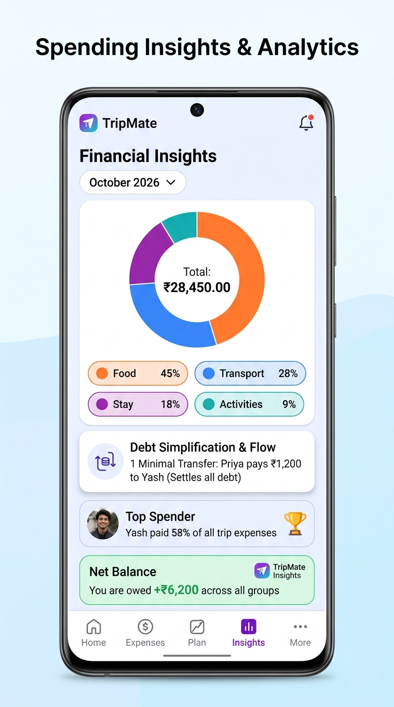
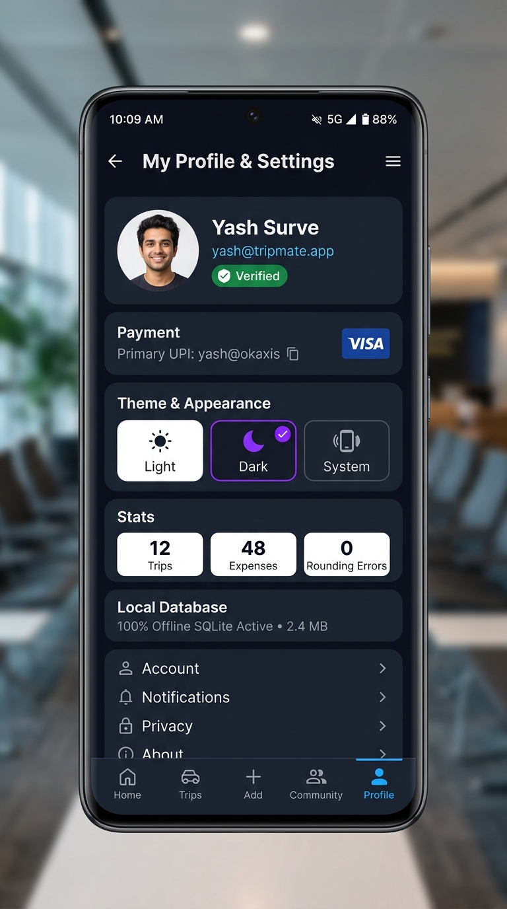
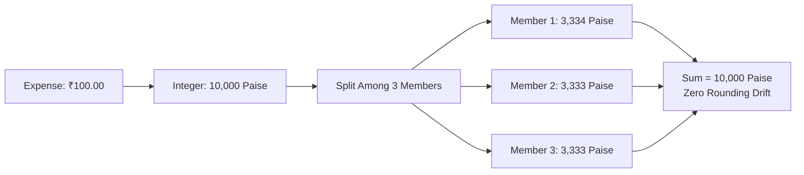
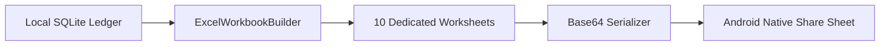
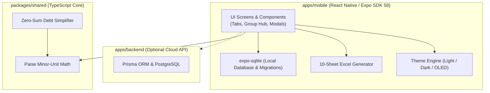

<div align="center">



# TripMate

### Shared Expenses & Epic Trips, Perfectly Sorted ✨

**100% Offline SQLite • Zero Rounding Errors • Minor-Unit Paise Precision**

<br/>

[](https://github.com/YashSurve2006/tripmate/releases/tag/v1.0.0)
[](https://github.com/YashSurve2006/tripmate/releases/download/v1.0.0/TripMate-release.apk)
[](.)
[](./LICENSE)

<br/>

[](https://reactnative.dev)
[](https://expo.dev)
[](https://www.typescriptlang.org)
[](https://docs.expo.dev/versions/latest/sdk/sqlite)
[](https://www.android.com)
[](https://hermesengine.dev)

</div>

---

## 📥 Download & Release

The production Android APK is built, tested, and available directly from GitHub Releases.

| Item | Details |
|:---|:---|
| 📦 **Release Tag** | [**`v1.0.0` Production Release**](https://github.com/YashSurve2006/tripmate/releases/tag/v1.0.0) |
| 🚀 **Direct Download** | [**`TripMate-release.apk` (99.3 MB)**](https://github.com/YashSurve2006/tripmate/releases/download/v1.0.0/TripMate-release.apk) |
| 🔐 **SHA-256 Checksum** | `4A6B709D9017AE23B468F558803FA899A13C46198530AD998E62FF294276DC83` |
| 📱 **Target OS** | Android 8.0+ (API 26–36) • `arm64-v8a`, `armeabi-v7a`, `x86`, `x86_64` |
| 🔒 **Privacy Guarantee** | 100% Offline • Zero tracking • All data stays inside local SQLite |

### ⚡ Quick Install on Phone
1. Download [**`TripMate-release.apk`**](https://github.com/YashSurve2006/tripmate/releases/download/v1.0.0/TripMate-release.apk) on your Android device.
2. If prompted, enable **Install Unknown Apps** in Android settings for your browser or file manager.
3. Tap the downloaded APK to install. The app launches immediately without any login or cloud account.

---

## 📱 App Screenshots

<div align="center">

<table>
  <tr>
    <td align="center">
      <a href="./docs/screenshots/01_dashboard.jpg">
        
      </a>
      <br />
      <b>Live Dashboard</b>
      <br />
      <sub>Filters · Spending KPIs · Budget ring</sub>
    </td>
    <td align="center">
      <a href="./docs/screenshots/02_group_details.jpg">
        
      </a>
      <br />
      <b>Group Hub</b>
      <br />
      <sub>2×2 action grid · Balances · Excel export</sub>
    </td>
    <td align="center">
      <a href="./docs/screenshots/03_documents_vault.jpg">
        
      </a>
      <br />
      <b>Bills & Docs Vault</b>
      <br />
      <sub>Camera · Gallery · PDF attachments</sub>
    </td>
  </tr>
  <tr>
    <td align="center">
      <a href="./docs/screenshots/04_add_expense.jpg">
        
      </a>
      <br />
      <b>Add Expense</b>
      <br />
      <sub>Unified currency input · Exact paise splits</sub>
    </td>
    <td align="center">
      <a href="./docs/screenshots/05_insights_analytics.jpg">
        
      </a>
      <br />
      <b>Analytics & Insights</b>
      <br />
      <sub>Category breakdowns · Debt flow graphs</sub>
    </td>
    <td align="center">
      <a href="./docs/screenshots/06_dark_mode_profile.jpg">
        
      </a>
      <br />
      <b>Dark Mode & Profile</b>
      <br />
      <sub>OLED theme · UPI ID · Local DB status</sub>
    </td>
  </tr>
</table>

</div>

---

## ⚡ Core Features

- **100% Offline SQLite**: Zero cloud sync required. All trips, expenses, splits, settlements, and member details reside strictly in your phone's internal storage (`expo-sqlite`).
- **Exact Minor-Unit Math**: Calculates every transaction in integer **paise** to eliminate floating-point drift.
- **Custom Amount-Wise Splitting**: Support for both Equal and Custom exact paise allocations. Members can owe custom amounts or ₹0 with live remaining calculations and balanced validation badges.
- **Safe Group Management**: One-tap **Clear Bills & Expenses** (resets balances to ₹0 while preserving group and members) and **Delete Group** (full transactional SQLite cascade and receipt file cleanup).
- **Direct WhatsApp Reminders**: Direct `https://wa.me/` deep-linking with international phone number normalization (e.g. `+91 88507 06982` → `918850706982`) and dynamic, pre-filled split and settlement messages.
- **Smart Settle-Up**: Greedy debt simplification reduces complex group debts into the fewest possible bilateral transfers.
- **10-Sheet Excel (.xlsx) Export**: Generates professional OpenXML spreadsheets with genuine `=SUM()` formulas and individual balance ledgers.
- **Document & Bill Vault**: Attach receipts, tickets, and bills via Camera, Gallery, or PDF, safely isolated per group.
- **Modern Responsive Design**: Polished 2×2 quick-action grid, unified currency input, and OLED Dark/Light themes.

---

## 🧮 Paise-Precision & Settle-Up Engine

TripMate stores all monetary values in integer minor units (**paise**), eliminating JavaScript floating-point errors.

### Exact Paise Split Flow



### Settle-Up Debt Simplification

The greedy `simplifyDebts()` algorithm simplifies multi-party debt networks:

| Before Settlement | After One-Tap Settlement |
|:---|:---|
| 🔴 **Rahul** owes Yash: **₹1,200** | ✅ Transfer card removed |
| 🔴 **Anisha** owes Yash: **₹800** | ✅ Net balances recalculate immediately |
| 🔴 **Priya** owes Rahul: **₹600** | ✅ Transaction recorded to history |
| **Sum of balances = ₹0** | ✅ Displays *"All Settled Up!"* when debts reach zero |

$$\text{Net Balance} = (\text{Total Paid} - \text{Fair Share}) + \text{Settlements Received} - \text{Settlements Paid}$$

### ⚖️ Custom Amount-Wise Expense Splitting

TripMate supports both **Equal Split** and **Custom Amount Split** modes in the Add/Edit Expense workflow:
- **Eligible Member List**: Displays every participant with currency-formatted numeric inputs.
- **₹0 Non-Payer Support**: Tap **₹0** to exempt non-consuming members from an expense.
- **Live Allocation Counters**: Real-time Allocated Total and Remaining balance calculations.
- **Status Badges**:
  - 🟢 `BALANCED` (Allocated matches total exactly — saving enabled)
  - 🟡 `UNDER-ALLOCATED` (Remaining amount displayed)
  - 🔴 `OVER-ALLOCATED` (Exceeded amount highlighted)
- **Decimal Precision**: Accurate integer paise handling for amounts like ₹123.45 with zero float rounding errors.

### 🛡️ Group Management & Financial Reset

Accessible via the group header menu (`⋮`) and the Group Overview hub:
- **Clear Bills & Expenses**: Clears all expenses, splits, payment records, settlements, and expense-linked receipt files. Retains the group, all members, and settings. Resets member balances to ₹0.00 instantly.
- **Delete Group**: Safe SQLite transaction that cascades through all group-specific tables (`expenses`, `expense_splits`, `expense_payments`, `settlements`, `activities`, `group_documents`, `group_members`, and `groups`) while cleaning up physical receipt files from disk. Never deletes shared user profiles or data from other groups.

### 💬 WhatsApp Integration & Smart Deep-Linking

Send dynamic expense splits and settlement debt reminders straight into WhatsApp chats via official `wa.me` deep-linking:
- **Phone Normalization**: Accepts raw formatted inputs (e.g. `+91 88507 06982`) and normalizes to E.164 without spaces or plus signs (`918850706982`). Automatically adds India `91` country code for 10-digit domestic numbers.
- **Dynamic Pre-Filled Messages**: Fully dynamic messages generated with actual group names, expense titles, total bill amounts, payer names, and the recipient's individual fair share.
- **Settlement Reminders**: Accessible from member profiles and the Balances tab to remind debtors with minimal transfers.

---

## 📊 10-Sheet Excel Export Engine

TripMate generates native OpenXML spreadsheets via SheetJS (`xlsx`) without cloud servers:



| # | Sheet | Content |
|:---:|:---|:---|
| 1 | **Executive Summary** | Group totals, date range, budget variance, zero-sum verification |
| 2 | **Expense Ledger** | Itemized expenses with real numeric cells and `=SUM()` formulas |
| 3 | **Member Summary** | Total paid, fair share, repayments, net balances |
| 4 | **Payment Records** | Multi-payer contribution breakdown |
| 5 | **Split Details** | Exact paise allocation per participant |
| 6 | **Settlement History** | Recorded debt settlements with timestamps |
| 7 | **Outstanding Balances**| Minimal bilateral settlement recommendations |
| 8 | **Category Analysis** | Spending distribution by category |
| 9 | **Daily Spending** | Chronological daily burn rate |
| 10 | **Receipts & Documents**| Document catalog with filenames and file sizes |

---

## 🏗️ System Architecture



---

## 📁 Repository Structure

```
📦 TRIPMATE/
│
├── 📸 docs/                                  ← Brand assets & native screenshots
│   ├── assets/logo.png
│   └── screenshots/ (01_dashboard → 06_dark_mode_profile)
│
├── 📱 apps/mobile/                           ← Expo SDK 58 React Native application
│   ├── android/                              ← Bare Android build configuration & Gradle scripts
│   ├── app/                                  ← Expo Router screens (Tabs, Groups, Add Expense)
│   ├── assets/                               ← App icons, splash screens, fonts
│   ├── components/                           ← Common modals & UI components
│   └── src/                                  ← SQLite database, 10-sheet Excel builder, tokens
│
├── 🧮 packages/shared/                       ← Shared financial engine, paise math & unit tests
│   ├── src/finance.ts                        ← Zero-sum balance & greedy debt simplification
│   ├── src/finance.test.ts                   ← Financial arithmetic unit tests
│   └── src/persistence.test.ts               ← Offline SQLite lifecycle tests
│
├── 🌐 apps/backend/                          ← Optional Prisma & Express API
│   ├── prisma/schema.prisma
│   └── src/ (routes, middleware, utils)
│
├── ⚙️ docker-compose.yml                     ← Local PostgreSQL configuration
├── 📄 package.json                           ← Monorepo workspace scripts
└── 📘 README.md                              ← Complete project documentation
```

---

## 🛠️ Local Development & Build Setup

### Prerequisites
- **Node.js**: `≥ 20`
- **JDK**: `21`
- **Android SDK**: `API 26–36`

### Commands

```bash
# 1. Install monorepo dependencies
npm install

# 2. Run TypeScript checks across all workspaces (mobile, shared, backend)
npm run typecheck

# 3. Run all test suites (141/141 unit, persistence, and E2E tests)
npm test

# 4. Start local development Metro bundler
npm run start:mobile

# 5. Build standalone release APK (portable across Windows, Linux, macOS)
npm run build:apk
# → Output: apps/mobile/android/app/build/outputs/apk/release/app-release.apk
```

---

## 🔧 Troubleshooting

| Issue | Cause & Resolution |
|:---|:---|
| `Unsupported class file major version` | Gradle requires **JDK 21**. Verify `java -version` returns `openjdk version "21.x.x"`. Set `JAVA_HOME` to your JDK 21 installation path. |
| `SDK location not found` | Set `ANDROID_HOME` or `ANDROID_SDK_ROOT` environment variable pointing to your Android SDK directory (e.g. `%LOCALAPPDATA%\Android\Sdk` on Windows or `~/Library/Android/sdk` on macOS). |
| `EADDRINUSE: address already in use 8081` | Metro bundler port conflict. Terminate existing Node/Metro processes or launch with `npx expo start --port 8082`. |

---

## 💾 Data Privacy & Backup

- **Zero Cloud Dependence**: No external accounts, trackers, or background telemetry.
- **On-Device Storage**: Data stays on your phone within the sandboxed application directory (`expo-sqlite`).
- **Easy Backup**: Export any group as a complete **10-Sheet Excel (.xlsx)** workbook anytime and share it via WhatsApp, Google Drive, or email.

---

## 📜 Documentation & Policies

- 📝 [**Changelog (CHANGELOG.md)**](./CHANGELOG.md) — Detailed version release notes.
- 🤝 [**Contributing Guide (CONTRIBUTING.md)**](./CONTRIBUTING.md) — Guidelines for code, tests, and pull requests.
- 🔒 [**Security Policy (SECURITY.md)**](./SECURITY.md) — Vulnerability reporting and data protection policy.
- 📄 [**License (LICENSE)**](./LICENSE) — TripMate is open source under the **MIT License**.

